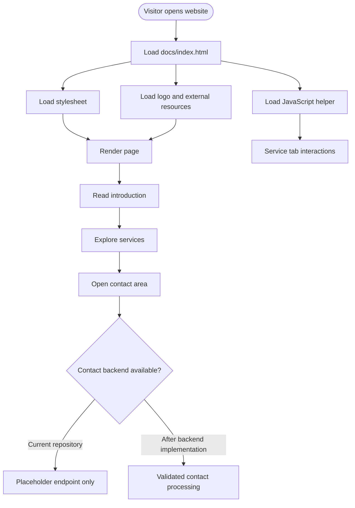

# ✨ EnClose | AI Consultation & Education Landing Page

<div align="center">


</div>

<div align="center">

**A static marketing website concept for AI consultation and education.**

       

</div>

> [!NOTE]
> **Prototype status:** this repository contains a static landing page only. It does not contain an AI engine, booking system, CRM, database, API server, or contact-form processing backend. The form currently points to a placeholder endpoint.

## 🌟 About EnClose

EnClose is a landing-page concept presenting AI consultation and education to businesses and professionals. The site communicates the importance of adopting AI, introduces two proposed service categories, and provides a contact section. Its current implementation uses HTML, generated Tailwind CSS, W3.CSS helpers, Google Fonts, a logo image, and a small vanilla JavaScript tab helper.

## ✨ Page sections

| Section | Purpose | Current implementation |
|---|---|---|
| 🧭 Navigation | Move between page sections | Hash anchors |
| 🎨 Hero | Show EnClose identity | Gradient background and logo image |
| 💡 Introduction | Explain the AI adoption message | Static copy |
| 🧩 Services | Present consultation and education | Tab layout plus `openMenu` helper |
| 📬 Contact | Show contact form UI | HTML form with unimplemented action |
| 🦶 Footer | Reserved footer area | Currently empty |

## 🧰 Technology stack

- HTML5 for semantic page structure.
- Tailwind CSS for utility classes and generated styles.
- W3.CSS for selected layout and presentation helpers.
- Vanilla JavaScript for service panel switching.
- Google Fonts for Inconsolata typography.
- Node.js and npm for development tooling.
- Static hosting for the `docs/` directory.

## 🚀 Getting started

### Prerequisites

Install Node.js, npm, and Git.

### Clone and install

```bash
git clone https://github.com/Brajesh31/Bifoga.git
cd Bifoga
npm ci
```

### Preview the site

```bash
npx serve docs
```

Open the local URL printed by the server. Use an HTTP server instead of opening the HTML file directly because the page uses root-relative paths and external resources.

### Rebuild Tailwind while developing

```bash
npm run tailwind
```

This runs the configured watcher from `src/input.css` to `docs/style.css`.

### Format HTML

```bash
npm run prettier
```

Review formatting output before committing generated or source changes.

## 🗂️ Repository structure

```text
Bifoga/
├── .github/
│   ├── ISSUE_TEMPLATE/
│   ├── workflows/
│   └── PULL_REQUEST_TEMPLATE.md
├── docs/
│   ├── img/logo.png
│   ├── diagrams/
│   ├── index.html
│   ├── style.css
│   └── documentation guides
├── src/input.css
├── main.js
├── package.json
├── package-lock.json
├── tailwind.config.js
├── CHANGELOG.md
├── CODE_OF_CONDUCT.md
├── CONTRIBUTING.md
├── GOVERNANCE.md
├── LICENSE
├── MAINTAINERS.md
├── README.md
├── ROADMAP.md
├── SECURITY.md
└── SUPPORT.md
```

See [Project Structure](docs/project-structure.md).

## 🔄 Browser and interaction flow



## 📚 Documentation

| Guide | Purpose |
|---|---|
| [Documentation hub](docs/README.md) | Index and reading paths |
| [Project overview](docs/project-overview.md) | Audience, goals, scope, and non-goals |
| [Architecture](docs/architecture.md) | HTML, CSS, JS, and asset relationships |
| [System design](docs/system-design.md) | Current design and proposed evolution |
| [Project structure](docs/project-structure.md) | Directory and file responsibilities |
| [Workflow](docs/workflow.md) | Browser lifecycle and user interactions |
| [Features](docs/features.md) | Page feature catalogue |
| [Installation](docs/installation.md) | Node/npm setup and preview |
| [Configuration](docs/configuration.md) | Tailwind and asset configuration |
| [Usage](docs/usage.md) | Visitor and maintainer guide |
| [API reference](docs/api-reference.md) | Browser helper and absence of HTTP API |
| [Interface summary](docs/api.md) | DOM helper and contact form boundary |
| [Data and privacy](docs/database.md) | Current data handling and future requirements |
| [Data flow](docs/data-flow.md) | Static assets, DOM, and form data |
| [Modules](docs/modules.md) | Source responsibilities |
| [Components](docs/components.md) | UI section inventory |
| [Testing](docs/testing.md) | Manual and automated checks |
| [Deployment](docs/deployment.md) | Static hosting practices |
| [Security](docs/security.md) | Threats and remediation |
| [Accessibility](docs/accessibility.md) | Keyboard and semantic HTML guidance |
| [Performance](docs/performance.md) | CSS, images, and remote resources |
| [Limitations](docs/limitations.md) | Existing defects and missing systems |
| [Future scope](docs/future-scope.md) | Prioritized improvements |
| [Glossary](docs/glossary.md) | Project terminology |
| [References](docs/references.md) | Technology documentation |
| [FAQ](docs/faq.md) | Common questions |
| [Troubleshooting](docs/troubleshooting.md) | Build and browser issues |
| [Development](docs/development.md) | Coding standards and PR workflow |
| [Coding standards](docs/coding-standards.md) | HTML, JavaScript, CSS, and documentation conventions |
| [Privacy](docs/privacy.md) | Current collection boundary and future safeguards |
| [Internationalization](docs/internationalization.md) | Localization planning |
| [Observability](docs/observability.md) | Static-host monitoring and privacy |
| [Maintenance](docs/maintenance.md) | Routine maintenance guidance |
| [Technical debt](docs/technical-debt.md) | Verified implementation gaps |
| [Diagrams](docs/diagrams/README.md) | Mermaid diagrams |
| [Asset library](assets/README.md) | Asset organization and provenance rules |
| [ADRs](docs/adr/README.md) | Architecture decisions |
| [Runbooks](docs/runbooks/README.md) | Development and release procedures |

## ⚠️ Known implementation issues

1. `main.js` is currently included using a stylesheet link instead of a script tag.
2. Tab click handlers pass panel IDs `Eat` and `Drinks`, while the actual panel IDs are `consultation` and `education`.
3. The `openMenu` helper iterates over the number of panels while updating tab links, which can leave active tab styling inconsistent.
4. The Education heading contains malformed markup.
5. Navigation references `#book`, but no matching booking section exists.
6. The contact form posts to `/action_page.php`, which is not implemented here.
7. The page references a map image path that is not present in the repository tree.
8. There is no server-side validation, privacy workflow, anti-spam control, consent processing, or data retention policy because no form backend exists.
9. W3.CSS and Google Fonts are external dependencies.
10. The footer is empty.

These should be fixed in application code before the site is advertised as a working business service.

## 🧪 Quality and security

CI checks provide basic static validation only. They do not replace cross-browser testing, keyboard checks, privacy review, or backend security validation. Never enter confidential data into the placeholder form. Read [SECURITY.md](SECURITY.md) and [docs/security.md](docs/security.md).

## 🤝 Contributing

Preserve the existing logo and visual identity. Include reproducible test steps and screenshots for visible changes, update Tailwind output after source changes, and document changes to form handling. See [CONTRIBUTING.md](CONTRIBUTING.md).

## 📜 License

MIT. See [LICENSE](LICENSE).

<div align="center">**EnClose, helping businesses close the gap between AI awareness and practical adoption.** ⭐</div>

Last updated: 2026-11-21 00:28 UTC
