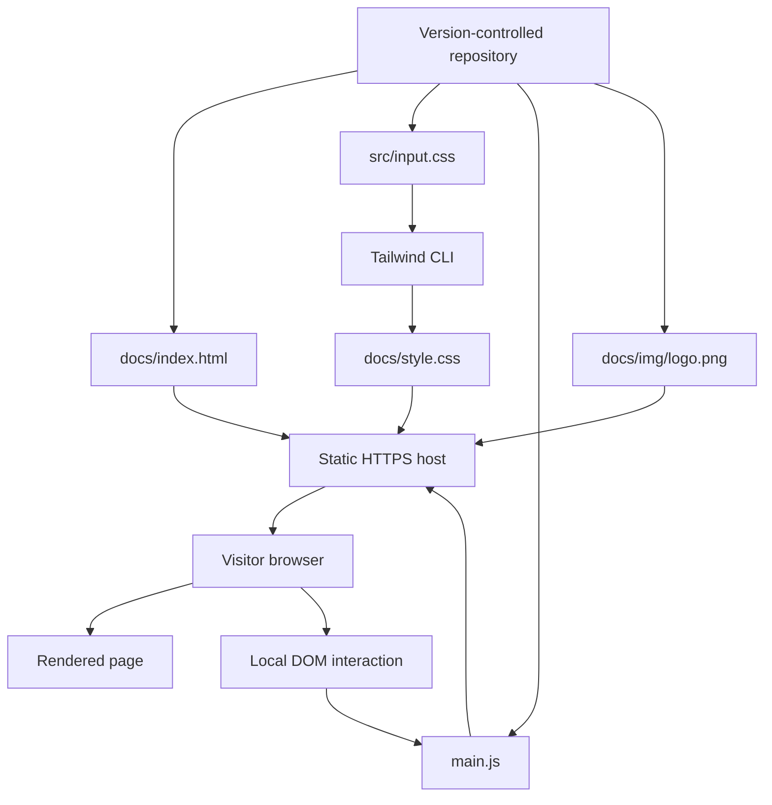

# 🏗️ Architecture

## 1. Overview

EnClose is currently a static website delivered to a browser. The repository separates page markup, authored styling, generated styling, and a small browser-side interaction helper. There is no application server, database, authentication layer, AI inference service, or HTTP API.

## 2. Runtime architecture

## 3. Source responsibilities

| File | Responsibility |
|---|---|
| `docs/index.html` | Page structure, copy, links, form presentation and resource references |
| `src/input.css` | Tailwind layers and authored global CSS |
| `docs/style.css` | Stylesheet output served by the page |
| `main.js` | `openMenu(evt, menuName)` DOM helper |
| `tailwind.config.js` | Tailwind file scanning and theme configuration |
| `package.json` | npm metadata and development scripts |
| `package-lock.json` | Locked dependency graph |
| `docs/img/logo.png` | Existing logo asset |

## 4. Build and delivery boundary

The configured Tailwind script watches `src/input.css` and writes to `docs/style.css`. A static host can serve the `docs/` directory. The production hosting provider and its configuration are not defined by this source tree.

## 5. Browser interaction boundary

The `openMenu` helper hides elements with class `menu` and displays the requested panel by ID. It also attempts to update tab styling. The markup and helper must use matching IDs and a consistent number of controls/panels. The existing page contains mismatches documented in the root README and troubleshooting guide. This architecture description does not claim those defects are fixed.

## 6. External dependencies

The page currently loads W3.CSS and Google Fonts externally. Their availability, privacy impact, and content-security-policy compatibility depend on the external providers. A future release should review whether these resources should be pinned, self-hosted, or removed.

## 7. Nonexistent subsystems

No database, API server, authentication, payment service, booking engine, or AI model integration exists in the repository. The contact form points to a placeholder endpoint. See [Data flow](data-flow.md), [API reference](api-reference.md), and [Limitations](limitations.md).

## 8. Evolution principles

Retain the static architecture while it meets validated needs. Introduce server-side services only when required for real data processing, booking, authentication, or AI inference. Any such change requires a threat model, privacy review, deployment plan, operational owner, and updated architecture diagrams.
