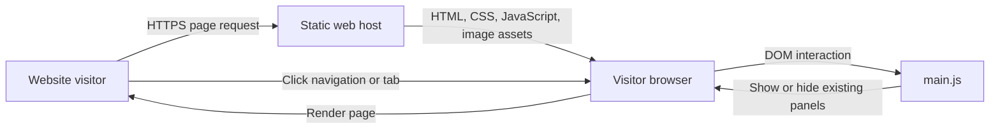
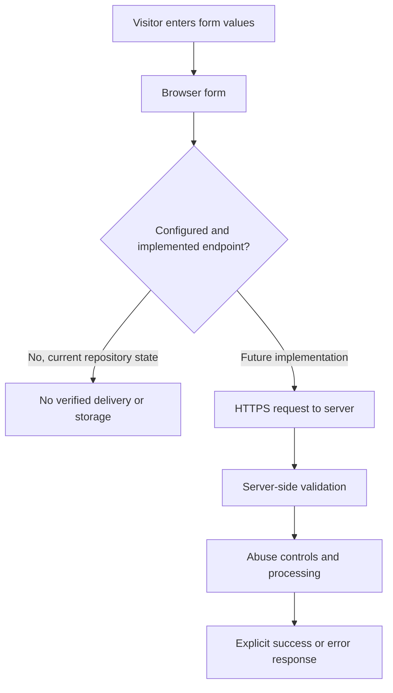

# 🔄 Data Flow

## 1. Current data model

The current EnClose website is a static presentation. Its primary content is authored in HTML and CSS and delivered to a visitor's browser by a static web host. The JavaScript file provides a small DOM interaction.

There is no repository-backed database, server-side business logic, analytics pipeline, AI inference pipeline, or form-processing service.

## 2. Level 0 data-flow view

The diagram describes the static delivery boundary. It does not imply that the visitor's form data is successfully transmitted or stored.

## 3. Level 1 page delivery

1. A visitor requests the published page.
2. The static host returns the HTML document.
3. The browser parses markup and discovers referenced stylesheets, scripts, fonts, and images.
4. The browser requests those assets from their configured paths.
5. The browser applies CSS and renders the page.
6. When a supported interaction is triggered, the browser executes the local JavaScript helper and updates element display/class state.

## 4. Form data boundary

The contact form visually collects values in the browser. Its current placeholder action is not backed by a handler in this repository. The flow therefore stops at the form boundary for the purposes of this project's verified architecture.

The future branch is a design checklist, not existing functionality.

## 5. Data classification

| Data | Current source | Current persistence |
|---|---|---|
| Page copy | `docs/index.html` | Version-controlled source |
| Styles | `src/input.css` and generated `docs/style.css` | Version-controlled files |
| Tab/menu state | Browser DOM | Temporary page state only |
| Contact field values | Visitor's browser form controls | No repository-provided storage |
| Environment values | No client runtime loader | None demonstrated |

## 6. Privacy implications

Do not claim that the current website stores, encrypts, deletes, or forwards visitor submissions. Those guarantees require an actual service and an implemented data lifecycle. Before introducing data collection, document purpose, lawful basis where applicable, fields collected, recipients, retention, deletion, security controls, and a visitor-facing privacy notice.
