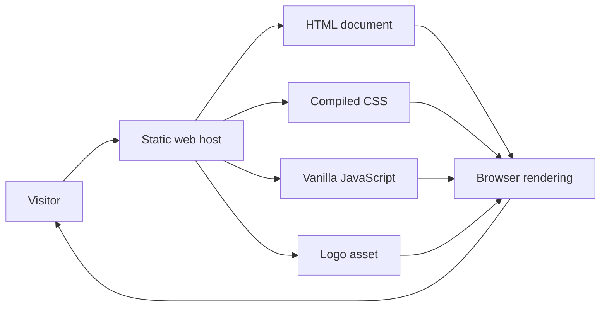
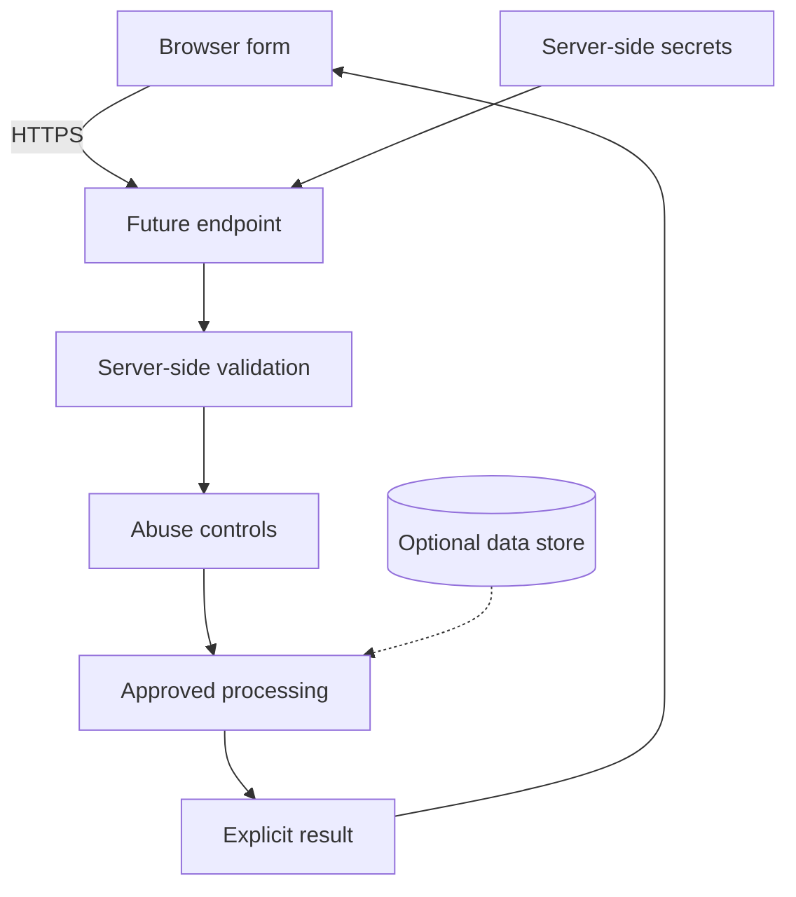

# 🧩 System Design

## 1. Current system

EnClose is a static presentation layer. It has no persistent application state, business service layer, or server-side data store. Browser interaction is limited to document navigation and a small service-panel helper.

## 2. Trust boundaries

| Boundary | Data/control | Trust consideration |
|---|---|---|
| Repository to static host | HTML, CSS, JS, image files | Review commits and deployment source |
| Static host to browser | Public website assets | Serve over HTTPS and configure headers |
| Browser interaction | DOM visibility and classes | Validate elements and preserve accessible state |
| Contact form | Visitor-entered values | No verified processing endpoint exists |

## 3. State model

The service helper changes element visibility in the current document. It does not fetch service details, save a selection, or persist state across visits. Panel identity depends on HTML IDs and class names. Existing markup and JavaScript have mismatches that are recorded in the project README and troubleshooting guide.

## 4. Data storage

There is no database. The contact form is not connected to a local or remote processing component. No submission storage, email notification, audit, or retention mechanism exists in this project.

## 5. Configuration and dependencies

Development scripts are configured in `package.json`. Tailwind scans configured HTML files, reads `src/input.css`, and emits `docs/style.css`. The browser also loads external W3.CSS and Google Fonts resources.

## 6. Proposed contact service architecture

If contact processing becomes a real requirement, keep the static presentation separate from the service boundary. The future service should validate fields server-side, apply rate limits and spam controls, store only necessary information, restrict access to submissions, and enforce a published retention schedule.

This future design is not implemented in the current repository.

## 7. Design principles

1. **Honest functionality:** public copy must not imply features that are not implemented.
2. **Accessibility:** navigation and tabs must work without a mouse.
3. **Privacy:** do not collect unnecessary personal or business information.
4. **Defence in depth:** browser validation is not a security boundary.
5. **Reproducibility:** generated CSS must come from versioned source.
6. **Maintainability:** IDs, paths, docs, and tests must remain consistent.
