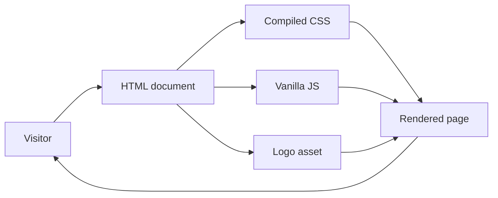

# 🧩 System design

## Current design

The current website is a static presentation layer. It has no persistent application state, business service layer, or server-side data store. Browser interaction is limited to document navigation and a small service-tab function.

## Page state

The service helper changes panel visibility. It does not fetch service details or save a selection. Panel identity depends on HTML IDs and class names. The present markup and JavaScript disagree about the IDs passed to the function.

## Data storage

There is no database. The contact form is not connected to a local or remote processing component. No submission storage, email notification, audit, or retention mechanism exists in this project.

## Configuration

Development scripts are configured in `package.json`. Tailwind scans the configured HTML files, reads `src/input.css`, and emits `docs/style.css`. The browser also loads remote W3.CSS and Google Fonts resources.

## Proposed production design

A future implementation that accepts contact enquiries should keep the static presentation layer separate from the contact API. The server must validate every field independently, reject spam, limit request rates, store only necessary information, protect access to submissions, and apply a published retention schedule.

## Design principles

1. **Honest functionality:** copy must not imply features that are not implemented.
2. **Accessibility:** navigation and tabs must work without a mouse.
3. **Privacy:** do not collect unnecessary personal or business information.
4. **Defence in depth:** browser validation is not a security boundary.
5. **Reproducibility:** generated CSS must come from versioned source.
6. **Maintainability:** IDs, paths, docs, and tests must remain consistent.
