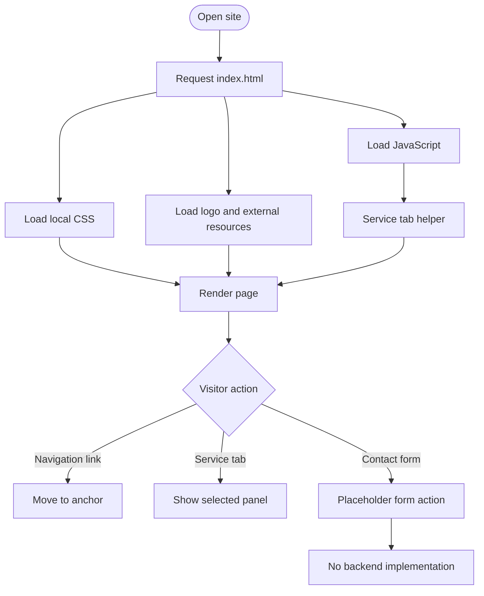
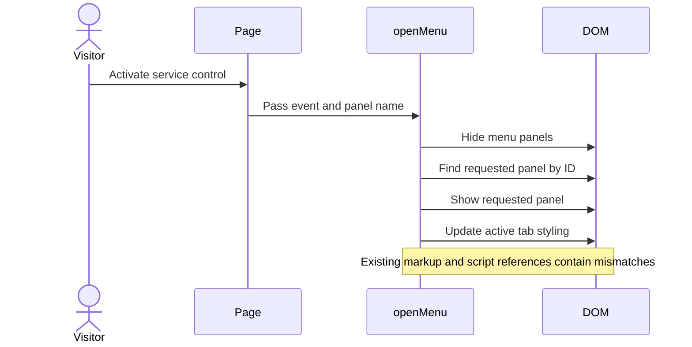
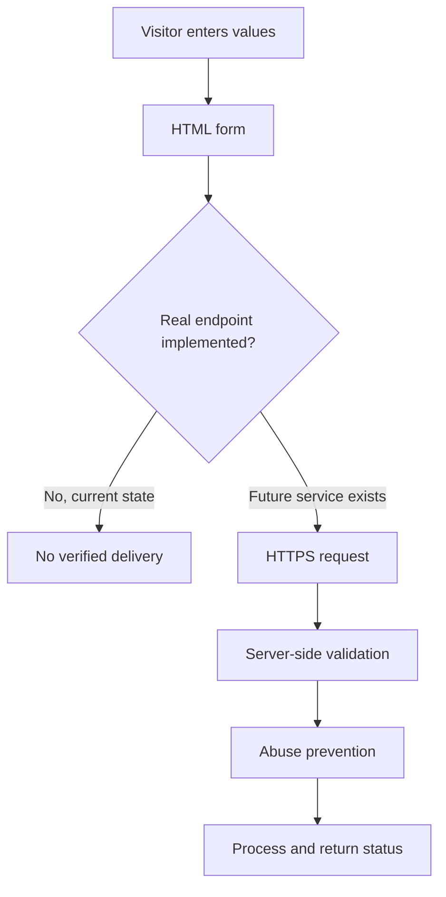
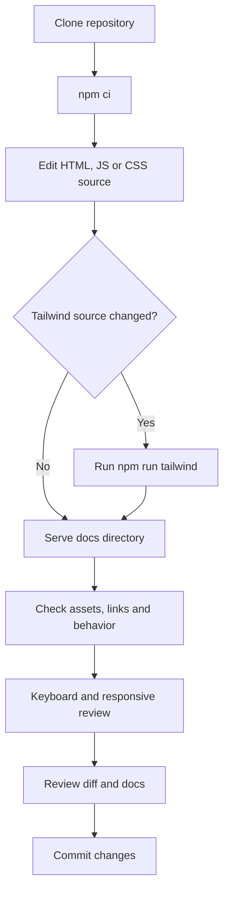

# 🔄 Application and Development Workflow

## 1. Browser loading sequence

1. Visitor requests the static site.
2. The host returns `docs/index.html`.
3. The browser requests local CSS, JavaScript, and the logo.
4. The page also requests external W3.CSS and Google Fonts resources referenced by the markup.
5. The browser parses, styles, and renders the page.
6. The browser-side helper is available for the intended service-panel interaction when correctly loaded.
7. The visitor navigates through page anchors or service controls.
8. The contact form action points to a backend route not included in this repository.

## 2. Current browser flow

## 3. Tab interaction sequence

## 4. Contact form boundary

Do not rely on the current form for actual business enquiries until a secure endpoint has been implemented and tested.

## 5. Development workflow

## 6. Diagram maintenance

Editable versions of the current system, navigation, form boundary, asset delivery, and development workflow are in [diagrams/](diagrams/README.md). Update them when the implementation changes.
