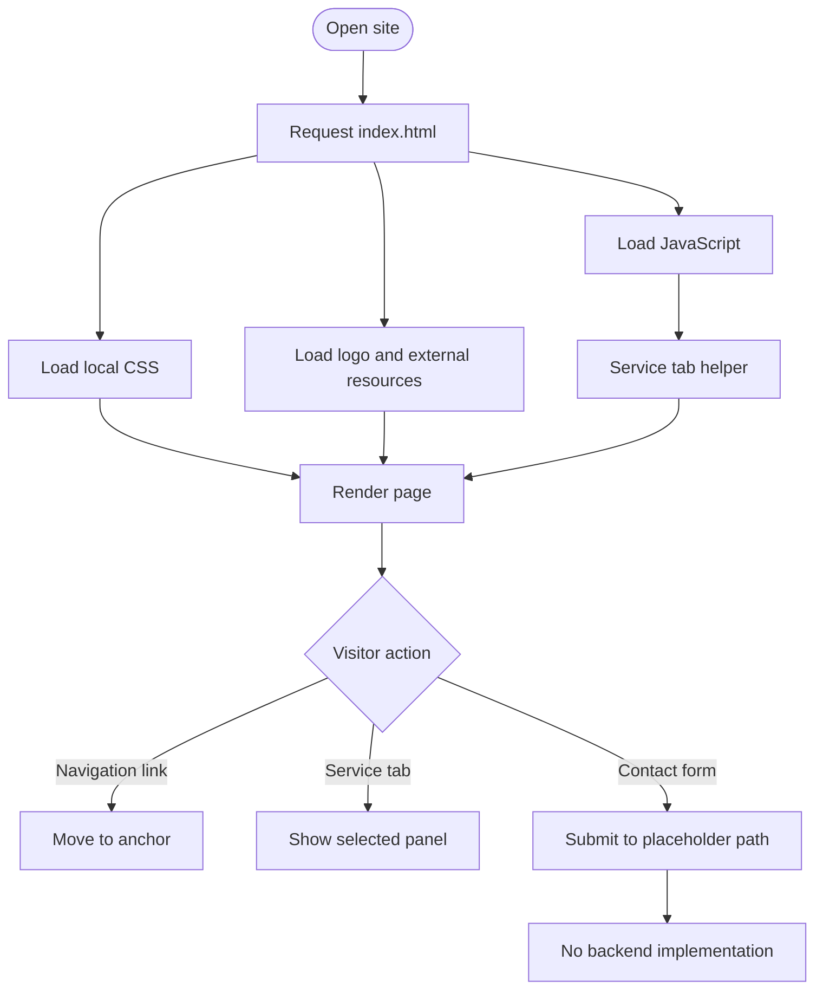
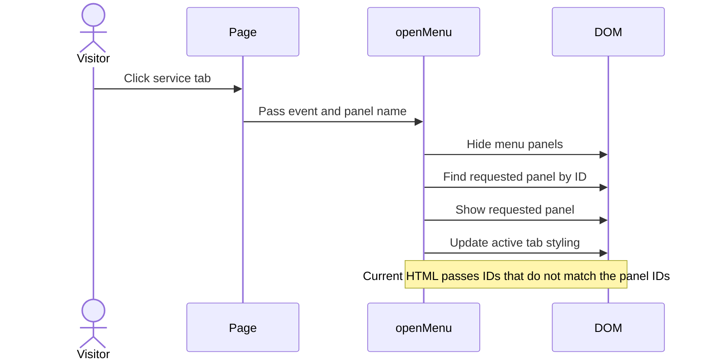
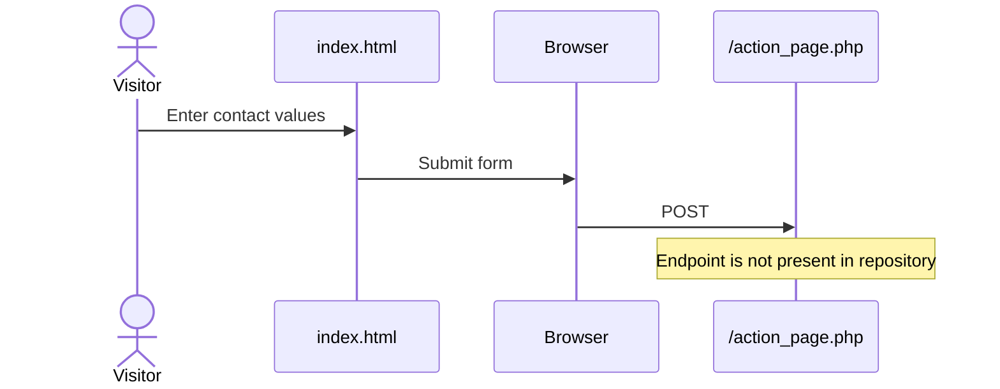

# 🔄 Runtime workflow

## Browser loading sequence

1. Visitor requests the static site.
2. Host returns `docs/index.html`.
3. Browser requests local CSS and the logo.
4. Browser requests remote W3.CSS and Google Fonts.
5. Page renders navigation, hero, introduction, services, and contact area.
6. JavaScript should provide service tab interaction once it is loaded correctly.
7. Visitor navigates using anchors or chooses a service tab.
8. The form points to a backend route not included in this repository.

## Current browser flow

## Tab interaction sequence

## Contact form boundary

Do not rely on this form for actual business enquiries until a secure endpoint has been implemented and tested.
